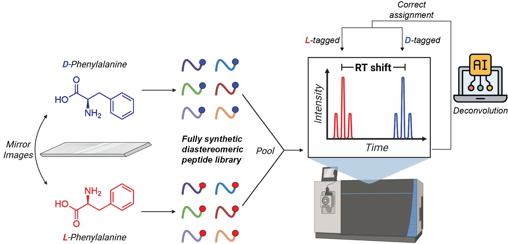
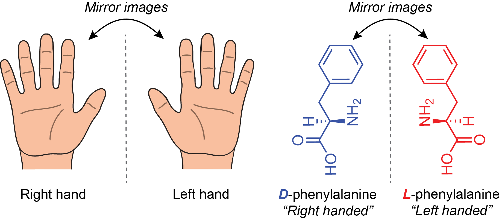

<p align="center"></p>

---

[](https://opensource.org/licenses/MIT)
[](https://huggingface.co/datasets/amirka20/StereoPep)

[**arXiv Preprint**](https://arxiv.org/abs/PLACEHOLDER) | [**HuggingFace Dataset**](https://huggingface.co/datasets/amirka20/StereoPep) | [**GitHub**](https://github.com/amirika20/StereoPep-Benchmarks) | [**Dataset Curation**](https://github.com/amirika20/StereoPep-Curation)

# StereoPep-Benchmarks

A comprehensive benchmarking suite for **peptide retention-time (RT) prediction**, with a central focus on **stereoisomer discrimination** — whether existing ML models can distinguish D-amino acids from their L-amino acid counterparts (specifically D-Phe `f` vs L-Phe `F`).

---

## What Are Stereoisomers?

**Stereoisomers** are molecules that share the same molecular formula and the same sequence of bonded elements, but differ in the three-dimensional orientation of their atoms. This distinction arises at **chirality centers** — carbon atoms bonded to four different substituents — where the spatial arrangement can produce non-superimposable mirror images.

<p align="center"></p>

The two mirror-image forms are called **enantiomers** (L- and D-). When a molecule has multiple chirality centers and the configurations differ at only some of them, the resulting isomers are called **diastereomers**. Unlike constitutional isomers, stereoisomers have identical connectivity, making them very difficult for sequence-based models to distinguish.

In the context of peptides, **L-amino acids** are the natural, biologically dominant form, while **D-amino acids** are their mirror-image counterparts. Despite having the same sequence string (e.g., the same SMILES graph topology), D- and L-amino acid residues interact differently with chromatographic columns, producing distinct **retention times** in LC-MS/MS experiments. This benchmark tests whether ML models can detect that difference.

---

## Datasets

### StereoPep (`stereopep-ano/StereoPep` on HuggingFace)

A custom dataset with a normalized retention-time target `B` (0–100 scale). Loaded via `datasets.load_dataset("stereopep-ano/StereoPep", ...)`.

| Split | Description |
|---|---|
| `stereopep` | Main train / val / test splits |
| `diastereomer_pairs` | Matched pairs `(seq_f, seq_F)` — same peptide with D-Phe vs L-Phe; `delta_B = B_f - B_F` |
| `diastereomer_pairs_trainval` | Same stereo pairs drawn from train/val sequences |
| `terminal_tag_pairs` | Pairs differing by an N-terminal tag addition |
| `point_mutant_pairs` | Pairs differing by a single amino-acid point substitution |

The test split is **not** a random subsample of the training material: it comes from a separately synthesized one-bead-one-compound (OBOC) library, so it is a genuinely held-out benchmark with its own length and scaffold distribution. This matters for interpreting several results below.

### Dataset configurations (`--dataset`)

Every benchmark accepts `--dataset`, selecting one of three configurations. `natural` and `noncanonical` **partition the full dataset exactly**, with no overlap and no remainder, so they answer complementary questions.

| `--dataset` | Contents | Train | Val | Test |
|---|---|---|---|---|
| `stereopep` (default) | everything; includes all pair evaluations | 41,455 | 4,607 | 2,726 |
| `natural` | canonical only — no D-Phe | 26,199 | 2,910 | 1,851 |
| `noncanonical` | the complement — D-Phe-containing only | 15,256 | 1,697 | 875 |

`benchmarks/stereopep_datasets.py` derives `noncanonical` by filtering and **asserts the partition on every load** (natural + noncanonical = stereopep, every noncanonical peptide contains D-Phe, no natural peptide does), so an upstream dataset change fails loudly instead of producing an ablation that no longer complements anything.

Both subsets skip the pair evaluations, for different reasons. `natural` contains no diastereomeric pairs at all. `noncanonical` contains the D-form of every pair but never the L-form, so scoring a pair would require predicting a peptide from the excluded half of the split — a cross-subset transfer test rather than the within-subset regression check these ablations are for. Use the full `stereopep` config for pair metrics.

### DIA (local)

A large LC-MS/MS DIA proteomics dataset stored in `data/`:

| File | Rows |
|---|---|
| `data/dia_train.txt` | ~102,600 |
| `data/dia_val.txt` | ~22,000 |
| `data/dia_test.txt` | ~22,000 |

Tab-separated format: `sequence` + `RT` (raw retention time in seconds). No stereoisomer pairs.

---

## Model Zoo

The same set of models is benchmarked on both datasets. Each model is run with 10 random seeds.

| Model | Script | Architecture |
|---|---|---|
| **GIN** | `gin_scratch.py` | Graph Isomorphism Network (Hu et al., ICLR 2020) from random init; SMILES via RDKit |
| **Pretrained GIN** | `pretrained_gin.py` | Same GIN loaded from a pretrained molecular checkpoint |
| **DeepLC** | `deeplc.py` | CNN ensemble (Bouwmeester et al., 2021); 3 models with kernel sizes 2/4/8; 4 parallel paths: atom counts, diamino composition, one-hot, global features |
| **DeepRT-CapsNet** | `deeprt_capsnet.py` | Capsule Network (Tang et al., 2020); 3 models with kernel sizes 8/10/12; amino-acid embeddings → Conv2d → primary/digit capsules |
| **Transformer** | `transformer_scratch.py` | Standard Transformer encoder trained from scratch |
| **ESM3-small / ESMC-300M / ESMC-600M** | `esm3_embedding.py` | Frozen ESM protein language model embeddings → MLP regression head |
| **PepLand** | `pepland.py` | Frozen PepLand peptide representation model (SMILES-level) → MLP head; embeddings precomputed by `pepland_precompute_embeddings.py` |
| **PeptideCLM-2** | `peptideclm2_embedding.py` | Frozen PeptideCLM-2 SMILES transformer (9 objective × size variants) → MLP head; precomputed by `peptideclm2_precompute_embeddings.py` |
| **ChemBERTa-2 (MLM / MTR)** | `chemberta2_embedding.py` | Frozen ChemBERTa-2 RoBERTa encoder (Ahmad et al., 2022) → MLP head; the only *general-purpose small-molecule* SMILES LM in the suite; precomputed by `chemberta2_precompute_embeddings.py` |
| **PepMNet** | `pepmnet.py` | Hierarchical GNN: atom-level NNConv → residue-level ARMA GNN → peptide-level pooling (Garzon-Otero et al., 2024) |
| **EGNN-3D** | `egnn_3d.py` | E(3)-equivariant GNN using 3D conformers precomputed by `precompute_conformers.py` |
| **Morgan FP MLP** | `morgan_fp_mlp.py` | RDKit Morgan fingerprints → MLP; sequence-order agnostic baseline |

**D-amino acid handling:** Every model includes explicit support for `f` (D-Phe). For example, DeepLC assigns it the same atom counts as L-Phe but a dedicated one-hot column (col 20); DeepRT-CapsNet gives it its own learned embedding vector; PepMNet appends a `stereo_flag` feature to the residue representation. The SMILES-level models (GIN, PepLand, PeptideCLM-2, ChemBERTa-2, Morgan FP) need no special handling in principle, since isomeric SMILES specify the stereocentre directly — but see the tokenizer caveat below, which shows this cannot be assumed.

### Frozen-embedding models: precompute first

PepLand, PeptideCLM-2 and ChemBERTa-2 keep their backbone frozen and train only an MLP head, so embeddings are computed **once per variant** and cached rather than recomputed every seed:

```bash
python benchmarks/chemberta2_precompute_embeddings.py --model mlm_77m,mtr_77m
python benchmarks/peptideclm2_precompute_embeddings.py --model hybrid_base
python benchmarks/pepland_precompute_embeddings.py          # needs the pepland_gpu env
```

Caches land in `benchmarks/pretrained_weights/*_embeddings.pt` and are gitignored (one exceeds GitHub's 100 MB limit). The benchmark scripts abort with the exact command to run if a cache is missing.

---

## ⚠️ Tokenizer caveat: ChemBERTa-2 silently discards stereochemistry

Anyone reproducing a ChemBERTa-2 result on a stereochemistry task should read this. It is a trap that produces a **false confirmation** of this benchmark's central claim.

The DeepChem ChemBERTa-2 repositories ship an atom-level SMILES `vocab.json` containing multi-character bracket tokens such as `[C@@H]`, `[nH]` and `[NH3+]` — but the accompanying `merges.txt` holds **only a version header, i.e. zero merge rules**, while `tokenizer_config.json` declares a byte-level BPE. Loaded the obvious way, through `AutoTokenizer.from_pretrained`, the resulting tokenizer can only emit the *single-character* vocabulary entries and silently drops everything else. Since `[`, `]`, `@` and `H` are not single-character entries, stereo descriptors vanish outright:

```
N[C@@H](Cc1ccccc1)C(=O)O   ->   N C ( C c 1 c c c c c 1 ) C ( = O ) O
```

No `[UNK]` is emitted to flag the loss. Under this tokenization **both members of every diastereomeric pair map to byte-identical input ids**, so the model is mathematically incapable of telling them apart and scores exactly chance — a result that looks like clean support for "models fail at stereo discrimination" while in fact measuring nothing but a tokenizer defect.

`chemberta2_precompute_embeddings.py` instead tokenizes with the atom-wise SMILES regex these vocabularies were built for (Schwaller et al., 2018; the pattern used by `deepchem.feat.SmilesTokenizer`), mapping tokens through each checkpoint's own `vocab.json`. Verified on the StereoPep SMILES:

- **lossless** — concatenating the tokens reconstructs the input exactly
- **100.0% vocabulary coverage**, 0 out-of-vocabulary tokens across 8,189,468 tokens
- **all 8,881 diastereomeric pairs receive distinct id sequences**
- longest sequence 289 tokens against the model's 512-position limit, so nothing is truncated

Both scripts assert these properties and abort rather than report a chance-level number. The same check was run on PepLand and PeptideCLM-2 (0 identical-embedding pairs each), confirming their near-chance discrimination scores reflect the models rather than preprocessing.

---

## Evaluation Metrics

**Overall regression** (test and train sets):
- Pearson *r*, Spearman *ρ*, Kendall *τ*, R², RMSE, MAE, mean error

**Stereo-pair metrics** (StereoPep only):

Given matched pairs `(seq_f, seq_F)`, `pred_delta = pred_f - pred_F` is computed and measured with:
- **Pairwise accuracy** — fraction of pairs where the model correctly ranks D vs L
- **Delta-Pearson / Spearman / Kendall** — correlation of predicted deltas with true deltas
- **Delta-AUC** — ROC-AUC treating the sign of the delta as a binary label

The same delta metrics are computed for **tag pairs** and **substitution pairs**.

---

## Repository Structure

```
StereoPep-Benchmarks/
├── benchmarks/                   # StereoPep benchmark scripts
│   ├── *.py                      # One script per model
│   ├── output/                   # JSON results: results_<model>[_<subset>]_seed<N>.json
│   ├── pretrained_weights/       # Checkpoints + gitignored *_embeddings.pt caches
│   ├── stereopep_datasets.py     # Shared --dataset selector; asserts the subset partition
│   ├── *_precompute_embeddings.py  # One-off embedding caches (PepLand/PeptideCLM-2/ChemBERTa-2)
│   ├── summarize_results.py      # Aggregates JSON → summary CSV/JSON + figures
│   ├── submit_benchmarks.py      # SLURM array job submitter (full dataset)
│   └── submit_noncanonical.sh    # SLURM array job for the D-Phe-only ablation
│
├── benchmarks_dia/               # DIA dataset versions of the same benchmarks
│   ├── *.py
│   ├── output/
│   └── submit_benchmarks.py
│
├── data/
│   ├── dia_train.txt             # DIA train split (TSV: sequence, RT)
│   ├── dia_val.txt               # DIA val split
│   ├── dia_test.txt              # DIA test split
│   ├── Tokenizer.py              # PeptideTokenizer + ContinuousValueTokenizer
│   └── PEPLM_WORDS.csv           # Vocabulary for the arxiv DeepRT model
│
├── arxiv/                        # Prototype: PyTorch Lightning DeepRT transformer
│   ├── layers/                   # Transformer blocks, attention, rotary PE, heads
│   ├── Model/deeprt.py           # Full PL model (KL-div + pairwise ranking loss)
│   ├── trainer/                  # PL trainer wrapper
│   └── inference/                # Jupyter notebooks for analysis, PCA, UI
│
├── metrics/                      # Aggregated results
│   ├── summary.csv / .json       # Mean ± std over 10 seeds per model (full dataset)
│   ├── summary_natural.*         # Canonical-only ablation
│   ├── summary_noncanonical.*    # D-Phe-only ablation
│   └── latex_*.tex               # Auto-generated LaTeX tables for the paper
│
├── rebuttal/                     # Discussion-period response notes
│   ├── chemberta2_results.md     # ChemBERTa-2 baseline write-up
│   └── noncanonical_ablation_results.md
│
├── figures/                      # Auto-generated plots (bar charts, scatter, radar)
├── submit.sh                     # Generic SLURM submission helper
└── requirements.txt
```

---

## Execution Flow

### 1. Run a single benchmark

```bash
python benchmarks/deeplc.py --seed 0 --epochs 50
```

Saves weights to `benchmarks/pretrained_weights/results_deeplc_seed0.pt` and results to `benchmarks/output/results_deeplc_seed0.json`. On re-run, weights are loaded and training is skipped.

### 2. Submit all benchmarks across seeds (SLURM cluster)

```bash
# Submit all models, seeds 0–9
python benchmarks/submit_benchmarks.py --seeds 0-9

# Submit specific models
python benchmarks/submit_benchmarks.py --benchmarks deeplc deeprt_capsnet --seeds 0-9

# Dry run (print SLURM scripts without submitting)
python benchmarks/submit_benchmarks.py --dry-run
```

Or use the generic SLURM helper directly:

```bash
./submit.sh --seeds 0-9 --benchmark -- benchmarks/deeplc.py
```

### 3. Aggregate results and generate figures

```bash
python benchmarks/summarize_results.py
```

Reads all `benchmarks/output/results_*_seed*.json`, writes `metrics/summary.csv`, `metrics/summary.json`, all `metrics/latex_*.tex` tables, and all `figures/*.png`.

---

## Installation

```bash
# Install PyTorch with the right CUDA wheel first:
pip install torch torchvision torchaudio \
    --index-url https://download.pytorch.org/whl/cu128

# Install PyG backends:
pip install torch-scatter torch-sparse torch-cluster \
    -f https://data.pyg.org/whl/torch-2.7.1+cu128.html

# Install remaining dependencies:
pip install -r requirements.txt
```

---

## Key Results

### 1. Strong regression, chance-level stereo discrimination

From `metrics/summary.csv` (mean ± std over 10 seeds, full dataset). ΔAUC of 0.5 is chance; 1.0 is perfect discrimination.

| Model | Pearson *r* | Spearman *ρ* | RMSE | Pairwise Acc. | ΔAUC |
|---|---|---|---|---|---|
| **DeepLC** | **0.800 ± 0.017** | **0.846 ± 0.016** | **6.68 ± 0.24** | 0.601 | 0.433 ± 0.105 |
| GIN | 0.787 ± 0.014 | 0.836 ± 0.012 | 6.81 ± 0.50 | 0.632 | 0.534 ± 0.107 |
| ESM3-small | 0.787 ± 0.008 | 0.826 ± 0.007 | 7.98 ± 0.54 | 0.600 | 0.515 ± 0.048 |
| Pretrained PepLand | 0.786 ± 0.014 | 0.835 ± 0.013 | 7.38 ± 0.29 | **0.639** | **0.614 ± 0.009** |
| ChemBERTa-2-MLM | 0.786 ± 0.040 | 0.833 ± 0.044 | 7.04 ± 0.60 | 0.625 | 0.570 ± 0.025 |
| DeepRT-CapsNet | 0.765 ± 0.022 | 0.804 ± 0.020 | 7.23 ± 0.48 | 0.431 | 0.439 ± 0.023 |
| PeptideCLM-2-Hybrid | 0.751 ± 0.019 | 0.794 ± 0.018 | 7.36 ± 0.26 | 0.639 | 0.422 ± 0.036 |
| Transformer | 0.746 ± 0.033 | 0.794 ± 0.028 | 7.18 ± 0.40 | 0.593 | 0.540 ± 0.087 |
| ChemBERTa-2-MTR | 0.720 ± 0.038 | 0.755 ± 0.037 | 7.60 ± 0.41 | 0.627 | 0.610 ± 0.031 |
| Morgan FP MLP | 0.507 ± 0.022 | 0.535 ± 0.027 | 9.47 ± 0.33 | 0.622 | 0.527 ± 0.022 |

Every model predicts retention time well (*r* up to 0.80) yet none reliably discriminates D-Phe from L-Phe. The best ΔAUC is ≈ 0.61, shared by PepLand and ChemBERTa-2-MTR (statistically indistinguishable), and several models fall *below* chance. Full pair metrics are in `metrics/latex_diastereomer_performance.tex`.

### 2. The ablations: performance holds without D-Phe, degrades with it

Pearson *r* and *R²* across the three dataset configurations (full: 10 seeds; subsets: 3 seeds):

| Model | *r* full | *r* natural | *r* non-canonical | *R²* full | *R²* natural | *R²* non-canonical |
|---|---|---|---|---|---|---|
| GIN | 0.79 | 0.77 | 0.72 | 0.56 | 0.53 | 0.50 |
| Pretrained GIN | 0.73 | 0.71 | 0.61 | 0.46 | 0.44 | 0.28 |
| Pretrained PepLand | 0.79 | 0.73 | 0.61 | 0.49 | 0.38 | 0.15 |
| PeptideCLM-2-Hybrid | 0.75 | 0.74 | 0.59 | 0.49 | 0.44 | 0.20 |
| ChemBERTa-2-MLM | 0.79 | 0.79 | 0.70 | 0.53 | 0.51 | 0.34 |
| **ChemBERTa-2-MTR** | 0.72 | 0.77 | **0.32** | 0.46 | 0.43 | **−0.20** |
| Transformer | 0.75 | 0.74 | 0.72 | 0.51 | 0.48 | 0.32 |
| DeepLC | 0.80 | 0.83 | 0.69 | 0.58 | 0.59 | 0.38 |
| DeepRT-CapsNet | 0.76 | 0.77 | 0.62 | 0.51 | 0.53 | 0.27 |
| Morgan FP MLP | 0.51 | 0.56 | 0.39 | 0.16 | 0.28 | **−0.10** |

Removing every stereochemically ambiguous peptide (`natural`) leaves performance essentially unchanged — so general retention-time prediction does not depend on the epimeric-pair structure of the dataset. Restricting to D-Phe-containing peptides (`noncanonical`) degrades **every** model, and pushes two below the predict-the-mean floor (negative *R²*).

**This is not simply a smaller-training-set effect.** The `noncanonical` subset has 42% less training data than `natural`, but the Pretrained GIN learning curve bounds that confound: its `frac=0.40` point uses 16,582 training peptides — within 9% of the subset's 15,256 — and costs only Δ*r* = −0.029 / Δ*R²* = −0.029 relative to the full run, whereas the non-canonical subset costs Δ*r* = −0.118 / Δ*R²* = −0.184. Data volume accounts for roughly 24% of the correlation loss and 16% of the *R²* loss; the remainder is the subset itself. Test-set %B spread is nearly identical across configurations (std 9.81 / 10.15 / 10.32), so this is not an artifact of *R²*'s variance dependence — RMSE moves the same way.

### 3. Why MTR collapses and MLM does not

ChemBERTa-2 ships two checkpoints that are **architecturally identical** (3-layer, 384-hidden RoBERTa) and differ *only* in pretraining objective:

| Variant | Pretraining objective |
|---|---|
| **MLM** | Self-supervised masked language modeling — mask ~15% of SMILES tokens and predict them |
| **MTR** | Supervised multi-task regression onto ~200 computed RDKit molecular descriptors |

On the non-canonical subset MTR collapses to *R²* = **−0.20** while MLM holds at 0.34 — a 0.55 gap between two checkpoints of the *same architecture*, and the largest *R²* drop of any model going from `natural` to `noncanonical` (−0.64, against −0.38 for the runner-up). The objectives explain it:

> **All 217 RDKit descriptors are byte-identical for a D-Phe/L-Phe pair.** Verified across 25 diastereomeric pairs: mean number of differing descriptors = **0.00**.

MTR's pretraining targets are therefore *provably invariant* to the stereocentre. Stereochemical variation is pure nuisance variance with respect to its objective, which supplies **zero gradient signal** for encoding it — and actively rewards discarding it. MLM's objective demands the opposite: reconstructing masked SMILES tokens requires representing `[C@@H]` versus `[C@H]`, since those are distinct vocabulary items it is scored on.

Reproduce with:

```bash
python -c "
from rdkit import Chem; from rdkit.Chem import Descriptors
a='N[C@@H](Cc1ccccc1)C(=O)O'; b='N[C@H](Cc1ccccc1)C(=O)O'
va=[f(Chem.MolFromSmiles(a)) for _,f in Descriptors.descList]
vb=[f(Chem.MolFromSmiles(b)) for _,f in Descriptors.descList]
print('differing descriptors:', sum(x!=y for x,y in zip(va,vb)), '/', len(va))"
```

Two scoping caveats, stated so the finding is not over-read:

1. **This explains the non-canonical regression collapse, not the discrimination metrics.** On the full dataset MTR has the nominally *best* ΔAUC (0.610 ± 0.031) against MLM's 0.570 ± 0.025 — a separation of only ~1.4 pooled standard deviations at *n* = 10 seeds, hence not a reliable ordering. Nothing should be built on it.
2. **MTR's embeddings do still differ between D and L** (0 identical pairs, verified). The input SMILES differ and the encoder propagates that; the claim is that the information is incidental rather than organized into something a downstream head can use.

A supporting diagnostic: on the non-canonical subset both variants fit training equally well (train RMSE 5.76 vs 5.58) and reach near-identical **validation** RMSE (5.95 vs 5.78), diverging only at **test** (10.74 vs 7.94). Validation is a random split of the same synthesis batches as training, whereas the test set is the independently synthesized OBOC library — so MTR generalizes in-distribution and fails across the library shift, specifically for non-canonical peptides.

---

## Reproducing the results

```bash
# Full benchmark, all seeds (SLURM)
python benchmarks/submit_benchmarks.py --seeds 0-9

# Canonical-only ablation (3 seeds, local serial)
./benchmarks/run_all_natural_local.sh

# Non-canonical-only ablation (SLURM array: 10 models x 3 seeds = 30 tasks)
sbatch benchmarks/submit_noncanonical.sh

# Aggregate everything
python benchmarks/summarize_results.py
```

`summarize_results.py` writes `metrics/summary{,_natural,_noncanonical}.{csv,json}`, all `metrics/latex_*.tex` tables, and all `figures/*.png`. Subset results are kept in separate tables from the full-dataset results so the two can never collide on one row.

---

## Citation

If you use the StereoPep dataset, please cite:

```bibtex
@misc{amirabbas_kazeminia_2026,
	author       = { Amirabbas Kazeminia and Michael Desgagné },
	title        = { StereoPep (Revision 3848950) },
	year         = 2026,
	url          = { https://huggingface.co/datasets/amirka20/StereoPep },
	doi          = { 10.57967/hf/8658 },
	publisher    = { Hugging Face }
}
```
